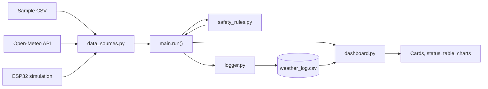
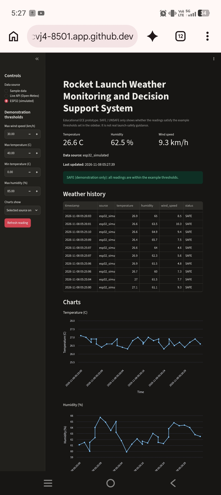

# Rocket Launch Weather Monitoring and Decision Support System

An educational ECE prototype that shows how simulated ESP32 sensor readings, live weather data, Python processing, CSV logging and a web dashboard work together.

> **Important:** SAFE / UNSAFE here only means the readings satisfy example thresholds chosen by the user. These are demonstration rules, not certified launch-safety limits. This project must not be used for real rocket-launch decisions.

## Abstract

This project builds a small weather-monitoring system for learning embedded systems and data handling. Readings come from one of three sources: a sample CSV file, the live Open-Meteo weather API, or a simulated ESP32 sensor whose logic is demonstrated in Wokwi. Each reading is validated, compared with configurable demonstration thresholds, logged to a CSV file, and shown on a Streamlit dashboard with a history table and charts.

## Objectives

- Demonstrate an ESP32 program that generates simulated temperature, humidity and wind-speed readings.
- Retrieve live weather data from a public API using Python.
- Keep all data sources in one common format so the rest of the system is independent of the source.
- Apply configurable demonstration thresholds and explain every failed rule.
- Log readings to CSV and display them on a mobile-friendly dashboard.
- Handle errors and invalid input clearly, and cover the code with unit tests.

## Hardware and Software Requirements

**Hardware:** none required. The ESP32 is simulated in Wokwi.

**Software and services (all free):**

- Python 3
- Streamlit and pandas (see `requirements.txt`)
- Wokwi (ESP32 simulation)
- Open-Meteo API (no API key needed)
- GitHub and GitHub Codespaces (development environment)

## Project Structure

```
.
|-- main.py              command-line runner (run() function)
|-- dashboard.py         Streamlit dashboard
|-- data_sources.py      sample, live API and simulated ESP32 sources
|-- safety_rules.py      validation and demonstration thresholds
|-- logger.py            CSV logging and history reading
|-- requirements.txt
|-- data/
|   `-- sample_weather.csv
|-- tests/               unit tests
|-- wokwi/
|   |-- sketch.ino       ESP32 program
|   `-- diagram.json     Wokwi circuit description
`-- docs/
    |-- architecture.md
    |-- block_diagram.md
    |-- test_results.txt
    `-- screenshots/
```

## System Architecture

See [docs/architecture.md](docs/architecture.md) for the full description.

## Block Diagram



## Working Methodology

1. The user selects a data source and sets demonstration thresholds on the dashboard (or gives a source name on the command line).
2. `main.run()` gets one reading from the chosen source. Every source returns the same dictionary: `source`, `temperature`, `humidity`, `wind_speed`.
3. `safety_rules.evaluate()` validates the numbers and returns SAFE or UNSAFE together with a list of reasons.
4. `logger.log_reading()` appends the reading, status and an India-time timestamp to a CSV file.
5. The dashboard shows the current reading, the status banner, the history table and charts for temperature, humidity and wind speed.

**ESP32 simulation:** the Wokwi sketch (`wokwi/sketch.ino`) changes each value by a small random step, keeps it within realistic limits, and prints a line over the serial port every 2 seconds. The Python function `get_esp32_simulated_reading()` reproduces the same logic so the dashboard can use it without hardware. The dashboard labels this source "ESP32 (simulated)".

## How to Run

```
pip install -r requirements.txt
python3 main.py sample        # or: live, esp32
streamlit run dashboard.py
python3 -m unittest discover -s tests -v
```

## Testing

The project has 23 unit tests covering the safety rules, logger, sample and simulated data sources, and the main runner. The most recent run (saved in `docs/test_results.txt`) passed all 23. The live API call is the one part not covered by automated tests, because its result changes continuously; it was checked manually.

## Results and Screenshots

Dashboard screenshots are stored in `docs/screenshots/`.





*Dashboard showing the temperature, humidity and wind-speed cards, the data source, the last-updated time and the SAFE / UNSAFE demonstration banner.*

## Limitations

- The ESP32 data is simulated, not measured by real sensors.
- The ESP32 source is a Python reproduction of the Wokwi logic, not a live serial link to the simulator.
- Thresholds are examples and are not real launch criteria.
- Live data covers one location (default: Sriharikota) and only temperature, humidity and wind speed.
- Logs from different sources share one CSV file.

## Future Scope

- Read data from a physical ESP32 with real sensors.
- Add more weather parameters such as pressure, visibility and cloud cover.
- Add alerts and forecast-based trends.
- Let the user choose the location on the dashboard.

## Conclusion

The project shows how an embedded-style data source, a public API, rule-based checking, logging and a dashboard can be combined into one tested system, and it is a base for extending toward real hardware.

## Author

Vanteru Amrutha
